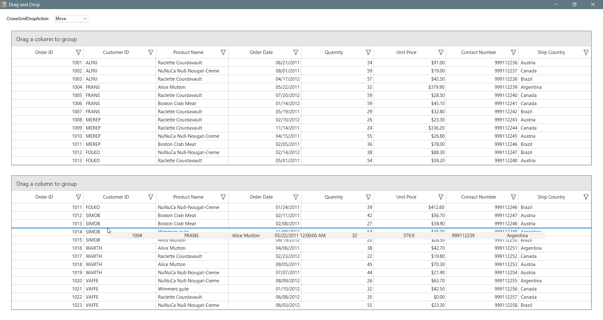

### Row drag and drop between two DataGrids

You can able row drag-and-drop between two SfDataGrid controls and control the behavior when dropping into another grid using the [CrossGridDropAction](https://help.syncfusion.com/cr/windowsforms/Syncfusion.WinForms.DataGrid.SfDataGrid.html#Syncfusion_WinForms_DataGrid_SfDataGrid_CrossGridDropAction) property:
- [CrossGridDropAction.Move](https://help.syncfusion.com/cr/windowsforms/Syncfusion.WinForms.DataGrid.Enums.CrossGridDropAction.html#fields) : The dragged records are removed from the source grid and inserted into the target grid.
- [CrossGridDropAction.Copy](https://help.syncfusion.com/cr/windowsforms/Syncfusion.WinForms.DataGrid.Enums.CrossGridDropAction.html#fields) :  The dragged records are copied to the target grid without removing them from the source grid.

> **Note:**  
> The `CrossGridDropAction` property applies **only** when rows are dragged between two `SfDataGrid` controls.  
> Dragging from other controls (such as `ListView`) into an `SfDataGrid` **does not support these actions**.

